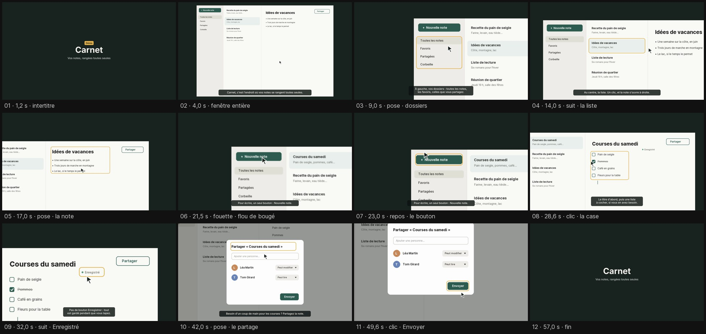

<a href="https://github.com/sebmake/sebmake-motiondesign-likeapplepls/releases/latest">

</a>

# sebmake-motiondesign-likeapplepls

For anyone who animates: it tells you how to animate a title, a list, a hero number, a logo, a product shot, a screenshot or a transition, then writes the After Effects or EffectCraft script that builds it.

Knowing which easing, duration or delay to use is hard, and "make it feel like Apple" doesn't help much. This skill answers with numbers.

Since 1.1 it also builds narrated walkthroughs of an app, one window and a camera that moves from button to button, as an EffectCraft project you can open and understand: every mechanism sits on its own named layer. Then it reads the project and the render back in numbers, and keeps your hand edits when it regenerates.

About 640 animations from eight Apple keynotes, March 2019 to September 2026, were measured frame by frame: 145 text animations, 122 object moves, 189 interface moves and 182 transitions. For each one: the duration, the distance, the delay between elements, and the closest cubic-bezier curve.

The skill's instructions are in French.

[Watch the example in the latest release](https://github.com/sebmake/sebmake-motiondesign-likeapplepls/releases/latest)

## Install

```bash
npx skills@latest add sebmake/sebmake-motiondesign-likeapplepls
```

It's one of the four [LikeApplePLS](https://github.com/sebmake/skills) skills, and `npx skills@latest add sebmake/skills/LikeApplePLS` installs all of them.

Or as a Claude Code plugin:

```bash
claude plugin marketplace add sebmake/sebmake-motiondesign-likeapplepls
claude plugin install sebmake-motiondesign-likeapplepls@sebmake-motion
```

You'll need Node 18 or later, Python 3.9 or later and ffmpeg, plus After Effects or EffectCraft. If you have no voice-over, the skill can make one with edge-tts, a free text-to-speech tool it installs in `~/.venv-sebmake-voix` only if you say yes. To let the skill run the script for you, start EffectCraft with its control port (`open -a EffectCraft --args --control 9877`) and keep its window in front, or the app won't answer.

## Why use it?

A lot of what people believe about "the Apple style" turns out to be wrong once you measure it.

Text mostly arrives on a cut, already on screen, and leaves the same way. No number ever counts up to its value (0 out of 27). Nothing bounces, no letter flies in one at a time, and the floating product doesn't float: in 10 of 13 held shots it moves less than 0.3% of the frame height.

Other moves come back with the same timing every time. Since 2025, a hero number appears two to eight times too large and blurred, then shrinks into place in 0.67 s, with its label 0.23 s behind. List lines light up 0.10 s apart (sometimes 0.05 s). A zoom into an interface takes 0.67 s, and over 95% of shot changes are straight cuts.

The skill asks what to animate, in which tool, at which format (16:9, 9:16 or 1:1) and with which colors. You see the plan element by element, in a table, before it writes a line of script. The script is ES3 JavaScript that runs in both After Effects and EffectCraft: 39 recipes and 10 transitions, each with its measured duration and its curve turned into KeyframeEase keys. Layers and keys get readable names, so you can edit them by hand.

For a walkthrough (the frames above), you describe the window, what to show and when, and the skill builds a layer per job. The window carries the camera: its anchor point is what you look at and its scale is the zoom. Highlights and the cursor are children of the window, so they follow the camera on their own. Subtitles stay fixed and each voice line sits at its moment. You pick how the camera lands on each framing: it settles, follows, whips or holds still. Before you see a render, a probe reads the composition and flags anything that leaves the frame or moves too fast without motion blur. On the 60-second test it caught a cursor drifting off screen and camera rests that jumped back to the wide shot.

In EffectCraft, the skill runs the script itself and makes check frames. In After Effects, you run it from File > Scripts > Run Script File. A number missing from your brief stays `[À FOURNIR]` ("to be provided"); the skill won't invent one.

## Reference

- **[SKILL.md](./skills/sebmake-motiondesign-likeapplepls/SKILL.md)** — The main skill: the questions, the animation plan, then the script.
- **[principes.md](./skills/sebmake-motiondesign-likeapplepls/references/principes.md)** — Why things move the way they do, and what never moves, each rule with its count.
- **[elements.md](./skills/sebmake-motiondesign-likeapplepls/references/elements.md)** — Element by element: what to animate, which recipe, how long, and what not to do.
- **[courbes.md](./skills/sebmake-motiondesign-likeapplepls/references/courbes.md)** — Every measured curve, as cubic-bezier and as After Effects keys.
- **[motion-spec.md](./skills/sebmake-motiondesign-likeapplepls/references/motion-spec.md)** — The `motion.json` format the script is built from.
- **[outils.md](./skills/sebmake-motiondesign-likeapplepls/references/outils.md)** — Running the script in After Effects and in EffectCraft.
- **[scene-demontee.md](./skills/sebmake-motiondesign-likeapplepls/references/scene-demontee.md)** — Narrated app walkthroughs built layer by layer: the camera, the probe, the edit loop.
- **[film-fonctionnalites.md](./skills/sebmake-motiondesign-likeapplepls/references/film-fonctionnalites.md)** — Feature films for software: a verb, a UI component taken out of the screen, a shape that plays.

The reference files are in French.

Nobody has run a script in After Effects yet; it wasn't available while the skill was built. The test animation was rendered three times in EffectCraft and measured again after each pass. The list lines still reach full opacity a little early, the edge of the screenshot comes into the frame after the zoom, and in 9:16 the small label above the title stays too small. Traps worth knowing: EffectCraft ignores easing curves unless the composition is open in the viewer, so the script opens it before setting any key. It doesn't apply a null's scale to an image parented to it, and it misplaces the children of an image larger than the composition, so the window carries the camera itself and never exceeds the frame (use the 4K format to zoom on a 2× screenshot). The walkthrough rules are conventions tested on two films, not measurements from the keynotes.

---

Not affiliated with, endorsed or sponsored by Apple Inc. Apple and Keynote are trademarks of Apple Inc., registered in the U.S. and other countries. After Effects is a trademark of Adobe. MIT License.
