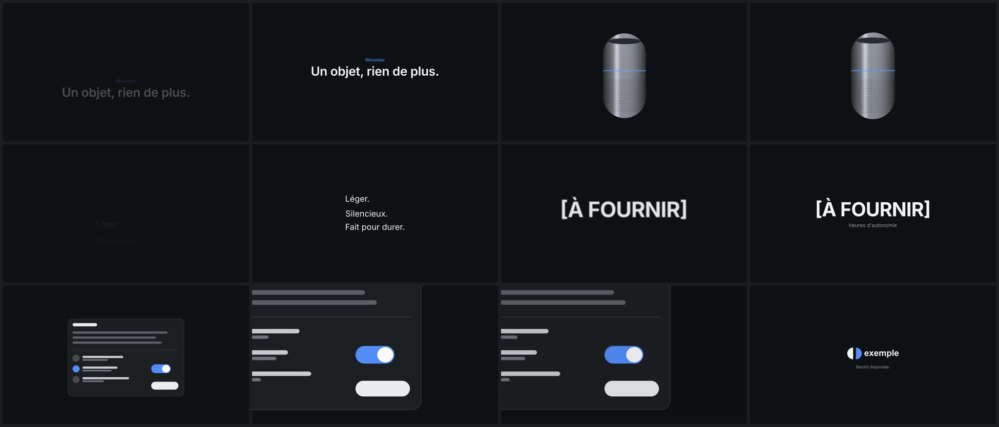

# sebmake-motiondesign-likeapplepls

Une skill Claude Code qui répond à la question « j'anime ça comment ? » pour un titre, une liste, un chiffre, un logo, une photo de produit, une capture d'écran ou une transition, puis écrit le script After Effects (ou EffectCraft) qui construit l'animation. Les durées et les courbes ne sortent pas d'un manuel : on les a mesurées image par image dans huit keynotes Apple.

*English below.*

## Ce que les mesures ont donné

On a suivi environ 640 animations, à la cadence d'origine, de mars 2019 à septembre 2026 : 145 animations de texte, 122 d'objets, 189 d'interfaces et 182 transitions. Pour chacune, on a relevé la durée, l'amplitude et le décalage entre éléments, puis on a ajusté la courbe sur une cubic-bezier connue en notant l'erreur.

Une bonne partie de ce qu'on croit savoir du « style Apple » ne tient pas à la mesure. Le texte arrive le plus souvent sur une coupe, déjà affiché, et repart de la même façon ; quand il fond, ça prend environ 0,4 s. Aucun chiffre ne compte jusqu'à sa valeur (0 cas sur 27), rien ne rebondit, aucune lettre n'arrive une par une. Le produit en lévitation ne flotte pas non plus : il bouge de moins de 0,3 % de la hauteur dans 10 plans tenus sur 13.

D'autres gestes, en revanche, reviennent avec une régularité de métronome. Depuis 2025, le chiffre héros entre deux à huit fois trop grand et flou, puis se pose en 0,67 s, et son libellé suit 0,23 s plus tard. Les lignes d'une liste s'allument à 0,10 s d'intervalle (ou 0,05 s), et un zoom dans une interface dure 0,67 s. Un filet de lumière ne traverse qu'une fois, en 0,28 s. Plus de 95 % des changements de plan sont des coupes franches, et le fondu au noir, toujours linéaire, dure 0,50 s.

## Comment elle travaille

Elle vous demande quels éléments animer et avec quels fichiers, dans quel outil, à quel format (16:9, 9:16 ou 1:1) et avec quel habillage, via un lien de design system ou des couleurs en HEX. Vous voyez ensuite le plan d'animation en tableau, élément par élément, avant qu'elle écrive une ligne de script.

Le script sort en JavaScript ES3, celui qu'After Effects comprend, et n'utilise que l'API qu'After Effects et EffectCraft partagent. Il s'appuie sur 39 recettes et 10 transitions, chacune avec sa durée mesurée et sa courbe traduite en clés KeyframeEase. Calques et clés portent des noms lisibles, pour qu'on puisse retoucher à la main. Dans EffectCraft, la skill lance le script elle-même par le canal de contrôle de l'app et fabrique des images de contrôle ; dans After Effects, vous l'exécutez par Fichier > Scripts > Exécuter le fichier.

Un chiffre absent du brief reste `[À FOURNIR]` : la skill n'en invente aucun.



## Installation

En plugin Claude Code :

```bash
claude plugin marketplace add sebmake/sebmake-motiondesign-likeapplepls
claude plugin install sebmake-motiondesign-likeapplepls@sebmake-motion
```

À la main, copiez `skills/sebmake-motiondesign-likeapplepls` dans `~/.claude/skills/`. Il vous faut Node 18 ou plus et Python 3.9 ou plus. Pour exécuter le script vous-même, After Effects suffit ; pour laisser la skill le faire, lancez EffectCraft avec son canal de contrôle (`open -a EffectCraft --args --control 9877`) et gardez sa fenêtre au premier plan, sinon l'app ne répond pas.

## Ce qui reste à éprouver

L'animation de test (15 s en vertical) a été rendue trois fois dans EffectCraft. Après chaque passe, on a refait les mêmes mesures sur le rendu et comparé aux keynotes. Le titre, le chiffre, le zoom et le logo collent maintenant aux valeurs relevées. Les lignes de liste atteignent leur pleine opacité un peu trop tôt, le bord de la capture entre dans le cadre après le zoom, et en 9:16 le surtitre reste petit. Personne n'a encore lancé un script dans After Effects, qui n'était pas disponible pendant le développement. La release v1.0.0 contient le rendu de l'exemple, 20 s en 16:9.

Un piège découvert pendant le développement vous évitera des recherches : EffectCraft ignore les courbes d'animation si la composition n'est pas ouverte dans la visionneuse. Le script l'ouvre donc avant de poser la moindre clé.

---

## English

A Claude Code skill that tells you how to animate a title, a list, a hero number, a logo, a product shot, a UI screenshot or a transition, then writes the After Effects (or EffectCraft) script that builds it. The timings come from roughly 640 animations measured frame by frame in eight Apple keynotes, 2019 to 2026.

Several of the numbers go against common habits. Text mostly arrives on a cut, no number ever counts up, nothing bounces and products don't float. Hero numbers since 2025 drop in oversized and blurred, then settle in 0.67 s. List lines light up 0.10 s apart, and over 95 % of shot changes are straight cuts.

It asks what to animate and where it'll run, shows you an element-by-element plan, then generates an ES3 script that runs in both tools: 39 recipes, 10 transitions, measured durations, curves converted to KeyframeEase. In EffectCraft it runs the script for you over the app's control port. Missing figures stay `[TO PROVIDE]`; it won't invent one.

Install with `claude plugin marketplace add sebmake/sebmake-motiondesign-likeapplepls`, then `claude plugin install sebmake-motiondesign-likeapplepls@sebmake-motion`. You'll need Node 18+ and Python 3.9+, plus After Effects or EffectCraft. Nothing has been run in After Effects yet.

---

Not affiliated with, endorsed or sponsored by Apple Inc. Apple and Keynote are trademarks of Apple Inc. After Effects is a trademark of Adobe. Licence MIT.
